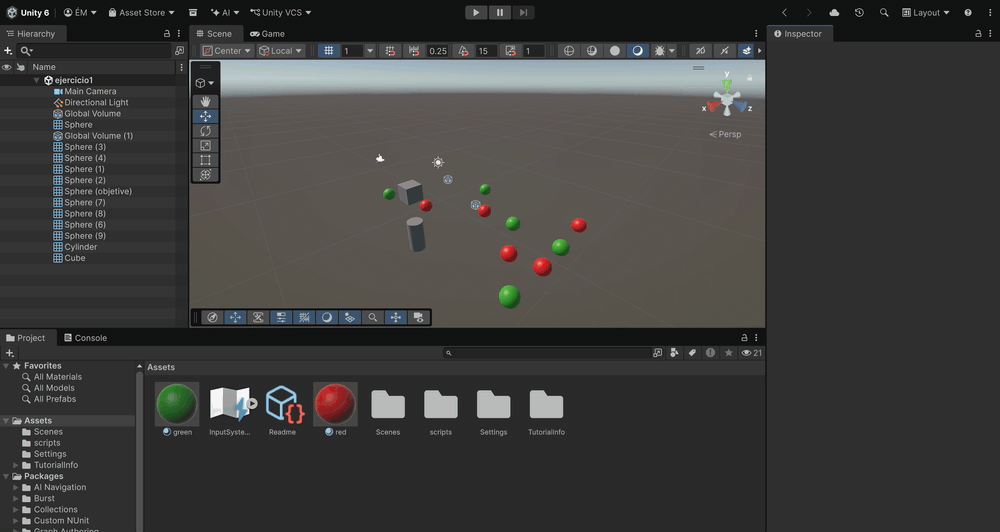
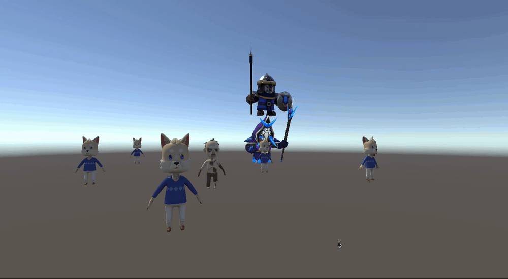
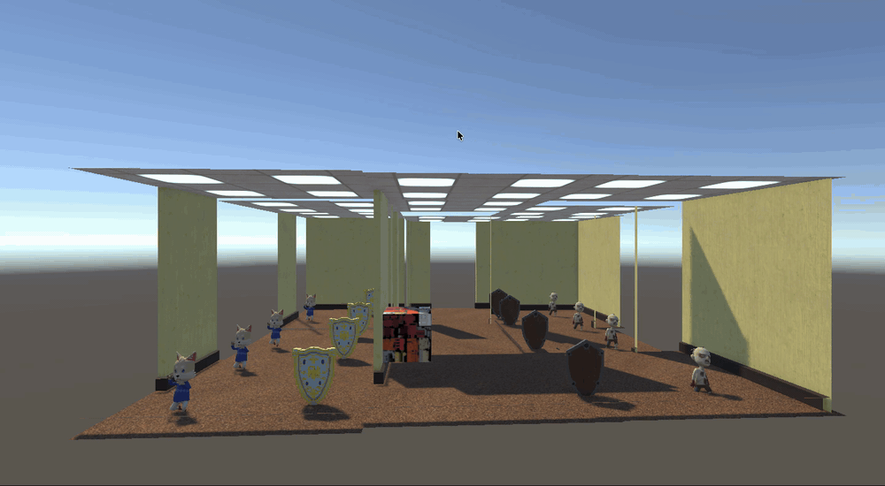
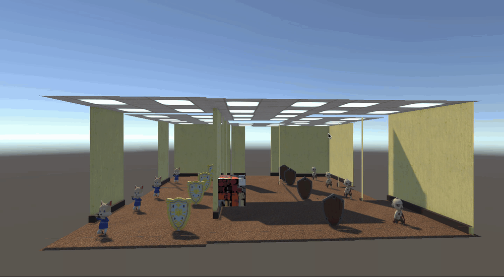
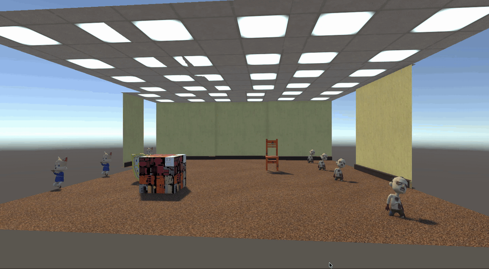
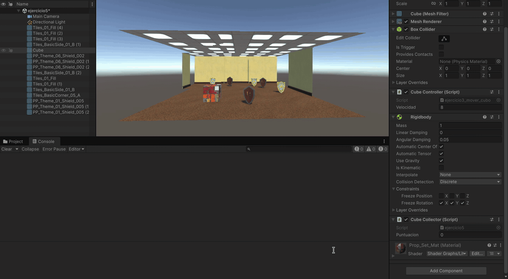
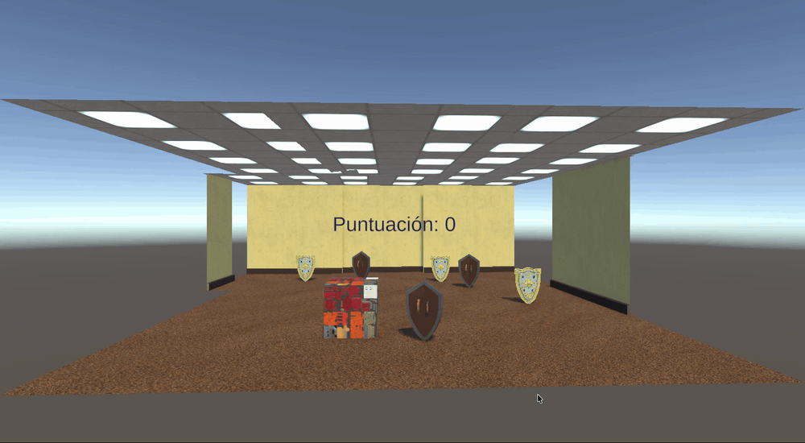
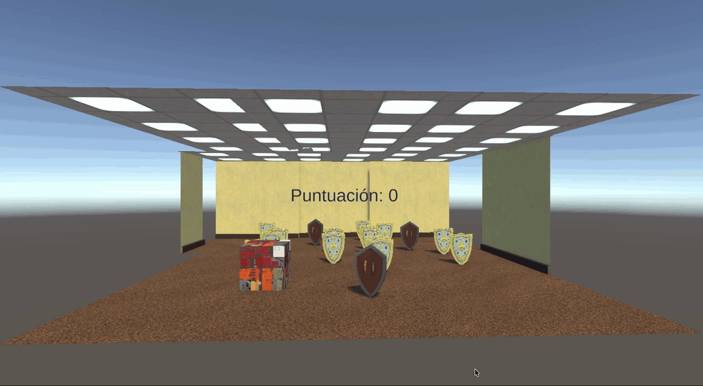
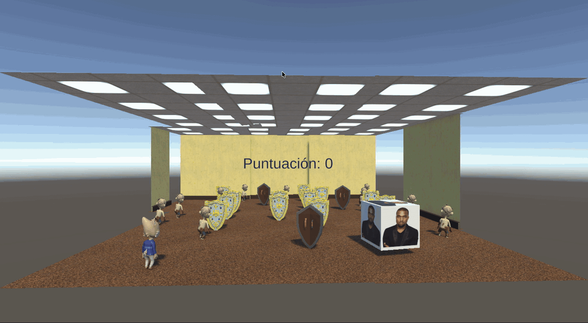

# Ejercicio Físicas 3D — Observer, eventos y UI

Asignatura: Interfaces Inteligentes — Curso 2026/27

Érika Crespo Molero

alu0101639185@ull.edu.es

## Hitos

En esta práctica he profundizado en el **patrón de diseño Observer** aplicado a Unity, entendiendo que el notificador no necesita conocer a sus observadores y que estos se suscriben y desuscriben a eventos mediante **delegados** de C#. He aprendido a declarar `public delegate Tipo NombreDelegado(Parámetros)` y `public static event NombreDelegado NombreEvento`, y a lanzarlos con `?.Invoke(...)` para notificar cambios de estado a todos los suscriptores sin usar bloques `switch` ni `SendMessage`. He comprobado la importancia de suscribirse en `OnEnable` y desuscribirse en `OnDisable` para evitar fugas de memoria cuando un objeto se destruye, y he visto cómo el notificador puede transportar información útil en el propio evento (por ejemplo, el `int tipoHumanoide` que indica qué tipo de humanoide ha colisionado con el cubo). También he consolidado el uso del motor de físicas 3D: la diferencia entre `Rigidbody` **dinámico** (afectado por gravedad y colisiones), **cinemático** (`isKinematic = true`, controlado por código con `MovePosition`/`MoveRotation`) y objetos **sin Rigidbody** (solo `Collider`); que para mover un `Rigidbody` no se debe usar `Transform` sino los métodos del motor de física en `FixedUpdate`; y que dos cuerpos cinemáticos no generan eventos de colisión entre sí, por lo que un humanoide cinemático necesita que el escudo sea dinámico para detectar la colisión y cambiar de color. He trabajado con los eventos `OnCollisionEnter` y `OnTriggerEnter`, con `CompareTag` (más eficiente que comparar `tag ==`), con el sistema de tags y con `Destroy` para eliminar objetos recogidos.
He aprendido a sustituir corrutinas por una combinación de `FixedUpdate` + un flag booleano + un `Transform` de destino, lo que resulta más robusto cuando hay eventos que pueden cambiar el objetivo mientras el personaje se mueve (simplemente se sobrescribe el destino). He profundizado en la UI de Unity mediante `Canvas` y `TextMeshProUGUI`, actualizando el texto cada vez que cambia la puntuación y gestionando mensajes temporales con un temporizador en `Update`. He usado `AudioSource.PlayOneShot` para superponer música de recompensa sin cortar otras reproducciones, `Mathf.Lerp` para oscurecer una `Light` gradualmente, e `Instantiate` para generar lluvias de objetos con `Random.Range` y `Random.rotation`. Finalmente, he aprendido a manejar umbrales de recompensa con división entera (`puntuacion / 100`) para no depender de comparaciones exactas `== 100`, a diagnosticar problemas con `Debug.Log` sistemáticos, y a detectar capturas por **distancia** (`Vector3.Distance`) en lugar de por colisión, lo que resulta más robusto cuando el perseguidor es cinemático.

## Ejercicios

### Ejercicio 1 — Esferas y cilindro con patrón Observer
Se crea una escena con 5 esferas (3 rojas de tipo 1, 2 verdes de tipo 2), un cubo y un cilindro. El cilindro actúa como **notificador**: cuando el cubo colisiona con él, publica el evento estático `OnCollisionWithCube`. Las esferas, como **observadores**, se suscriben en `OnEnable` y se desuscriben en `OnDisable`. Al recibir el evento, las de tipo 1 se dirigen hacia una esfera de tipo 2 fijada de antemano, y las de tipo 2 se dirigen hacia el cilindro. El desplazamiento se realiza con `MovePosition` en `FixedUpdate`, leyendo la posición del objetivo en cada paso para que si este se mueve, la esfera corrija el rumbo.

### Ejercicio 2 — Sustituir los objetos por humanoides
Se reemplazan las geometrías primitivas del ejercicio anterior (esferas, cubo y cilindro) por humanoides descargados, manteniendo **la misma mecánica y los mismos scripts**. El cilindro humanoide sigue siendo el notificador, los humanoides de tipo 1 y tipo 2 siguen actuando como observadores suscritos al evento `OnCollisionWithCube`, y las tags `"tipo1"` y `"tipo2"` se asignan a los nuevos humanoides. No se necesita código nuevo porque el patrón Observer no depende del modelo visual, sino de las tags y de la suscripción al evento, por lo que el cambio es puramente estético.

### Ejercicio 3 — Humanoides y escudos
Se adapta la escena anterior para añadir escudos de tipo 1 y de tipo 2. El cubo se convierte en el notificador: detecta con qué tipo de humanoide colisiona y publica el evento `OnColisionHumanoide(int tipo)` transportando el tipo impactado. Los humanoides de tipo 1 se desplazan hacia un escudo seleccionado cuando el cubo toca un humanoide de tipo 2, y los de tipo 2 se desplazan hacia el escudo de tipo 2 más cercano cuando el cubo toca un humanoide de tipo 1. Los escudos del grupo 2 son objetos físicos con `Rigidbody` dinámico y `Collider`, y cuando un humanoide colisiona con uno de ellos cambia de color a amarillo mediante `rend.material.color`.

### Ejercicio 4 — Teletransporte y orientación por proximidad
Se añade un objeto de referencia que actúa como notificador: cuando el cubo entra en su trigger, publica el evento `OnCuboAproximado`. Los humanoides de tipo 1 se **teletransportan** instantáneamente a un escudo objetivo fijado en el Inspector (usando `rb.position = ...` para que el motor de física registre el cambio de posición). Los humanoides de tipo 2 se **orientan** hacia un objeto de la escena mediante `Quaternion.LookRotation`, anulando la componente `Y` de la dirección para que solo giren sobre el eje vertical y no se inclinen.

### Ejercicio 5 — Recolectar escudos y puntuación en consola
El cubo actúa como recolector: al entrar en el trigger de un escudo, comprueba su tag con `CompareTag`, suma 5 puntos si es `EscudoTipo1` o 10 si es `EscudoTipo2`, imprime la puntuación total por consola y destruye el escudo con `Destroy`. Aquí no se necesita el patrón Observer porque solo hay un suscriptor (el propio cubo actualizando su puntuación); la pista del enunciado sugiere usar directamente `OnTriggerEnter(Collider other)`.

### Ejercicio 6 — Interfaz de puntuación con Canvas
Se añade un `Canvas` con un `TextMeshProUGUI` que muestra la puntuación del cubo. El script mantiene el mismo `OnTriggerEnter` del ejercicio anterior y, tras cada suma, llama a `ActualizarUI()` que escribe `textoPuntuacion.text = $"Puntuación: {puntuacion}"`. La referencia al texto se asigna en el Inspector arrastrando el objeto del Canvas al campo público, y se comprueba que no sea `null` antes de actualizar para evitar excepciones si se olvida asignar.

### Ejercicio 7 — Recompensa cada 100 puntos
Se amplía el ejercicio anterior: cada vez que la puntuación cruza un múltiplo de 100, se otorga una recompensa visible en la UI, suena una música mediante `AudioSource.PlayOneShot` y cae una lluvia de objetos prefabricados. El control de múltiplos se hace con `int recompensasQueTocan = puntuacion / 100` y un `while` que otorga recompensas mientras `recompensasOtorgadas < recompensasQueTocan`, evitando comparaciones exactas `== 100` que fallarían si la puntuación saltara por encima. La lluvia se genera con un `ObjectSpawner` que instancia `cantidad` prefabs en posiciones aleatorias alrededor del spawner con `Random.Range` y `Random.rotation`, y el mensaje de recompensa aparece durante `duracionMensaje` segundos gestionado con un temporizador en `Update`.

### Ejercicio 8 — Escena prototipo con perseguidor
Se monta una escena con un personaje jugador controlable que recoge escudos y acumula puntuación (sin lluvia de objetos). Un **perseguidor** cinemático lo sigue con `MovePosition` y, cuando la distancia entre ambos es menor que `distanciaCaptura`, publica el evento `OnJugadorAtrapado`. Al dispararse, varios observadores reaccionan en paralelo sin conocerse entre sí: el `PlayerCollector` resetea la puntuación a 0 y actualiza la UI; el `GestorAtrapado` reproduce una música con `PlayOneShot` y guarda una nueva intensidad objetivo para la `Directional Light`, que se interpola gradualmente con `Mathf.Lerp` en `Update` hasta `intensidadOscura`; y todos los `ObservadorNPC` giran instantáneamente hacia el jugador con `Quaternion.LookRotation`. El flag `yaAtrapado` en el perseguidor evita que el evento se dispare cada frame mientras están juntos.

### Ejercicio 9 — Ejercicio 3 con el cubo como objeto físico
Se reimplementa el ejercicio 3 (humanoides y escudos) haciendo que el cubo sea un **objeto físico dinámico** controlado por el jugador con las flechas o WASD, en lugar de un objeto estático que espera a ser golpeado. El script `CubeController` obtiene el `Rigidbody` en `Awake`, congela la rotación con `FreezeRotation` para que el cubo no vuelque al moverse y, en `FixedUpdate`, lee los ejes `Horizontal` y `Vertical` con `Input.GetAxisRaw` para asignar `rb.linearVelocity` manteniendo la componente `Y` (para que la gravedad siga actuando). Al ser ahora un cuerpo dinámico, se puede conducir el cubo contra los humanoides de tipo 1 o tipo 2 para disparar el evento `OnColisionHumanoide` del ejercicio 3 a voluntad, y el cubo responde a la física, choca con los escudos y puede ser empujado por el resto del entorno.

